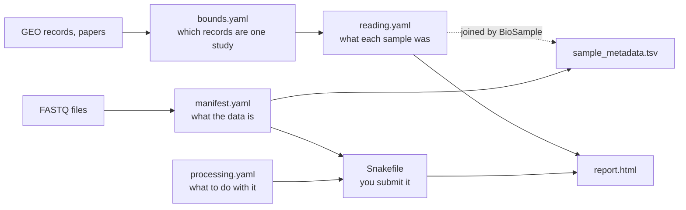

<!-- A centered, sized logo and title need inline HTML and precede the first heading, which the
     default ruleset forbids (MD033, MD041). Scope the exception to this masthead; every other rule
     stays on for the README. -->
<!-- markdownlint-disable MD033 MD041 -->
<p align="center">
  
</p>

<h1 align="center">seqforge</h1>
<!-- markdownlint-enable MD033 MD041 -->

seqforge reads public sequencing studies and their files, and writes down what they are, so that
each dataset can be processed the right way. It reads a **study**: which GEO records and papers
make it up, and what each sample was. It compiles a **dataset**: which technology made the FASTQ
files, and a pipeline you submit to run them. One report shows both.

A model writes an answer only where code can check it, and code decides whether the answer stands.



**See it first:** the [example reports](https://liuhlab.github.io/seqforge/examples/) on the docs
site show two studies read from public GEO records.

## Install

```bash
pip install seqforge
```

That gives you the `seqforge` command and the compiler. Two lab packages are not on PyPI, and some
steps need them: `liulab-data` (the archive's records, papers and ontologies) for reading a study,
and `liulab-genome` (genomes and annotations) for compiling against a real genome.

```bash
pip install "liulab-genome @ git+https://github.com/liuhlab/liulab-genome.git" \
            "liulab-data   @ git+https://github.com/liuhlab/liulab-data.git"
```

Inside the lab, `pixi install` pulls both. Reading a study also needs the lab's model gateway:
[Getting started](https://liuhlab.github.io/seqforge/getting-started/) says what each path needs.

## Develop

Everything runs through [pixi](https://pixi.sh), not `pip`, `conda` or `venv`:

```bash
pixi install                     # build the environments
pixi run check                   # lint, format check, type check and the three test lanes
pixi run test                    # the unit lane only
pixi run test-corpus             # the corpus lane only
pixi run test-external           # the lane that needs programs seqforge does not own
pixi run docs-build              # build the docs site, strict
pixi run -- pre-commit install   # once per clone: the fast hooks, not the suite
```

Tests enforce most of the project's rules, so `pixi run check` is where a rule fails. CI runs it on
every pull request.

## Where to look

| For | Read |
| --- | --- |
| Using it: examples, how it works, guides, reference | **<https://liuhlab.github.io/seqforge/>** |
| Working on it: the rules, and where to read next | [`AGENTS.md`](AGENTS.md) (`CLAUDE.md` links to it) |
| Why it is built this way, one decision per file | [`docs/adr/`](docs/adr/), and beside the code each one governs |
| What a term means | [`GLOSSARY-MAP.md`](GLOSSARY-MAP.md), and one `GLOSSARY.md` per part |
| Measurements, dated | [`docs/research/`](docs/research/) |
| What changed, and when | [`CHANGELOG.md`](CHANGELOG.md) |
| What is not built yet | the [open issues](https://github.com/liuhlab/seqforge/issues) |
