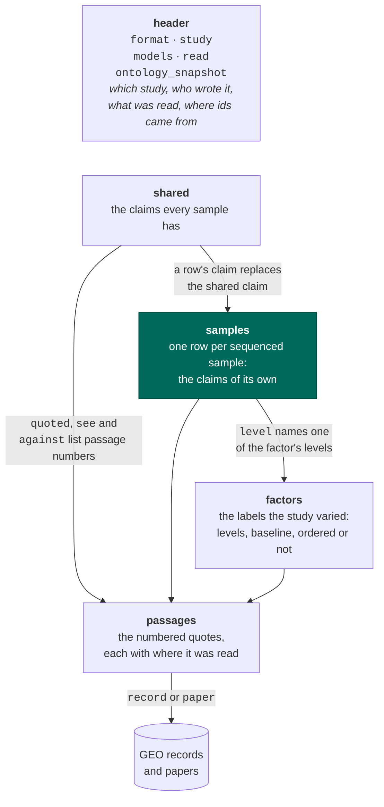
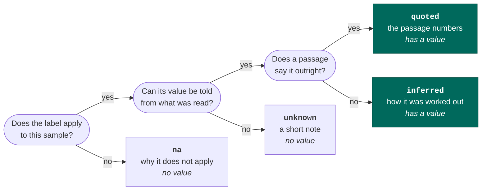
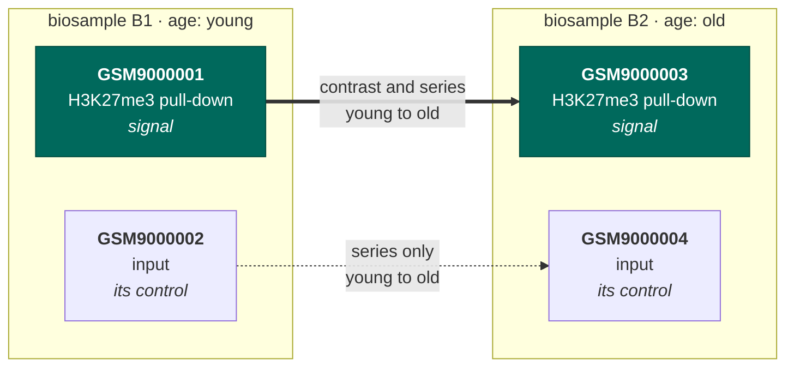

# The reading file

A **study** is one piece of research: the experiments that one paper reports, or one project that
has no paper yet. The [bounds file](bounds.md) says which GEO Series and which papers belong to a
study. GEO is the Gene Expression Omnibus, and a Series is one deposit of samples in it.

The study's **reading** says what each sequenced sample was: the species, the tissue, the
treatment, the assay, and which labels the study varied between its samples. Each statement comes
with the words that back it, the words that speak against it where the sources disagree, and a
probability. The reading file writes the reading down, one file per study, in YAML, a plain-text
format of fields and lists.

This page describes every field and every rule of the file. It is all you need to read one.

## A short example

This is part of the reading that the reading job wrote for the standard-set study GSE112068, a time
course of human lung fibroblasts treated with the drug bleomycin. The job read only the GEO
records. The excerpt keeps one factor, four shared claims and one of the 23 samples, and a comment
marks each cut.

```yaml
format: 2
study: GSE112068
models:
  reading: deepseek/deepseek-flash
  probabilities: typesafe/jev-1.14.0
read:
- records
read_detail: The records of GSE112068 and their 23 sequenced samples; no paper.
ontology_snapshot:
  source: 'liulab-data ontology store: cellosaurus-57.0, chebi-257, cl-2026-11-13, efo-3.96.0, hsapdv-2025-01-23,
    ncbitaxon-2026-11-26, pato-2026-10-01, uberon-2026-11-05'
  date: 2026-11-28
passages:
  # ... passages 1 to 3 cut
  4:
    record: GSE112068
    field: Series_summary
    quote: bleomycin at 0 ug/ml, 2 ug/ml and 40 ug/ml for 2 h
  5:
    record:
    - GSM3056966
    - GSM3056967
    - GSM3056968
    field: Sample_characteristics_ch1
    quote: 'dose: 0 ug/ml'
  # ... passages 6 to 20 cut
  21:
    record: each_sample
    field: Sample_library_strategy
    quote: RNA-Seq
  # ... passages 22 to 25 cut
  26:
    record: each_sample
    field: Sample_organism_ch1
    quote: Homo sapiens
factors:
  # ... the factors treatment and time_point cut
  dose:
    levels:
    - 0_ug_ml
    - 2_ug_ml
    - 40_ug_ml
    baseline: 0_ug_ml
    ordered: true
    quoted:
    - 4
    p: 0.99
shared:
  species:
    text: Homo sapiens
    term: NCBITaxon:9606
    quoted:
    - 26
    p: null
  assay:
    text: RNA-Seq
    term: EFO:0008896
    quoted:
    - 21
    p: 1.0
  target:
    na: RNA-Seq has no pull-down target
    p: 1.0
  control_type:
    na: Untreated samples are baseline, not control libraries
    p: 1.0
  # ... the other shared claims cut
samples:
  GSM3056966:
    biosample_accession: SAMN08742201
    biosample:
      id: B1
      inferred: no text read ties this library's material to another's
      p: null
    dose:
      text: 0 ug/ml
      value: 0
      unit: ug/ml
      level: 0_ug_ml
      quoted:
      - 5
      p: 1.0
    # ... the sample's other claims, and the other 22 samples, cut
```

Read it from the samples outward:

- Sample `GSM3056966` got a dose of 0 ug/ml. Passage 5 quotes the words from its GEO record, and its
  level on the factor `dose` is `0_ug_ml`.
- The factor `dose` says the study varied the dose on purpose, in three ordered levels, and compared
  the others with `0_ug_ml`.
- The claims under `shared` hold for every sample: each is human, and each library is RNA-Seq,
  RNA sequencing. `target` and `control_type` do not apply, so each is marked `na`.
- Each `p` is the chance that the claim is right, as Jev judged it. Jev is a model that answers
  yes-or-no and multiple-choice questions with a probability.
- `biosample_accession` is the sample's id in BioSample, the archive of sample records.

## Where the files are

| File | What it is |
| --- | --- |
| `<folder>/<ID>/reading.yaml` | A study's reading. `seqforge study write-reading --out <folder>` writes one per study from the reading pass's answers. `seqforge study run` runs that pass and that write after the bounds, and calls models through the model gateway. |
| `evals/standard-set/<ID>/job-reading.yaml` | The reading that the reading job wrote for each of the 50 studies of the standard set, written with `study write-reading --name job-reading.yaml`. |
| `evals/standard-set/<ID>/reading.yaml` | A reading worked by hand, for five studies of the standard set: GSE100021, GSE112068, GSE117724, GSE235532 and GSE241718. |

`<ID>` is the study's name, such as `GSE112068`. `study write-reading` never overwrites a file that
is already there. It writes no file for a study that the job refused, and it writes no text that the
format check rejects.

Two commands read one file. Neither needs a model or a network.

```bash
seqforge study check-reading reading.yaml
seqforge study relations reading.yaml
```

The first command checks the file against this page. See [The check](#the-check). The second command
prints what the reading implies between its samples, such as replicates and contrasts. See
[The relations](#the-relations).

`seqforge run --study <folder>` joins a reading into the compiler's sample table,
`sample_metadata.tsv`. It matches each reading row to a compiled sample by
[`biosample_accession`](#samples-and-shared-claims).

## The file at a glance

A reading file has five parts. The arrows show how one part points at another.



A sample's claims are its own row plus whatever `shared` adds. A claim that a source backs gives
passage numbers, and each passage names the record or the paper that holds the quote. A claim that
a source contradicts names that passage too, under `against`. A claim on a label that the study
varied also names its level.

## The fields

Every field below is required unless the table says otherwise. The check rejects a file with any
other top-level field.

| Field | Holds |
| --- | --- |
| `format` | The whole number `2`. See [When the format changes](#when-the-format-changes). |
| `study` | The study's name: the GEO Series it was picked by, such as `GSE100021`. It cannot be empty. |
| `models` | Who wrote the file. `reading` is the model that read the study. `probabilities` is the model that gave the `p` values. Either may be `null`. |
| `read` | What the model read: one or more of `records`, `abstract` and `full_text`. No other word is accepted. |
| `read_detail` | Optional. One sentence that says which records and which papers were read. |
| `ontology_snapshot` | Where the file's ontology ids came from. See [The ontology snapshot](#the-ontology-snapshot). |
| `passages` | The quotes that back the claims, each under its number. It may be empty: `{}`. |
| `factors` | The labels that the study varied on purpose, each under its label. It may be empty: `{}`. |
| `shared` | The claims that every sample has unless its own row says otherwise. It may be empty: `{}`. |
| `samples` | One row per sequenced sample, each under the sample's id, such as `GSM2668015`. At least one. |

The reading job writes `read` from what it had: always `records`, then `abstract` when a paper's
abstract or full text was read, then `full_text` when a paper's full text was read.

### The ontology snapshot

An ontology is a published list of terms, each with an id, such as UBERON for anatomy.
`ontology_snapshot` names, once for the whole file, where the file's ontology ids came from.

| Field | Holds |
| --- | --- |
| `source` | The dated snapshot of the ontologies, or the service that the ids were looked up in. It cannot be blank. |
| `date` | Its date, written as a date such as `2026-11-21`. |

- `ontology_snapshot` is required when any claim has a `term`. A `term` on `sex` does not count,
  because a sex term is one of this page's own words and not an ontology id.
- For ids from liulab-data's ontology store, `date` is the UTC day that the pass opened the store,
  which pinned its snapshots for the pass. liulab-data is the lab's package for archive records,
  papers and ontologies.

## Passages

A quote is written once in the file, however many claims it backs. `passages` is keyed by number, a
whole number of 1 or more. Each passage holds the quote and where it was read, in one of two ways.

| Field | Holds |
| --- | --- |
| `quote` | The words, copied from the source as one unbroken span. It cannot be empty. |
| `record` and `field` | For a quote from a GEO record: the record, and the field of it. |
| `paper` and `section` | For a quote from a paper: the paper, written `pmid:<number>`, and the section of it. |

A passage has `record` and `field`, or it has `paper` and `section`. The check rejects a passage
with only one of a pair, or with parts of both.

`record` takes one of three forms:

- one record id, such as `GSE100021` or `GSM2668015`;
- a list of record ids, when each of those records holds the quote in that field;
- the word `each_sample`, when every sample record of the study holds the quote in that field.

A record quote is exact: the field holds it character for character. A paper's text comes with
markup and broken lines. So a paper quote is exact after the markup is removed and each run of white
space is collapsed to one space. A paper's `section` is where the quote was found: `title`,
`abstract`, or a section of the full text.

The format check does not look for a quote in its source. The reading job finds every quote in its
record or paper when it writes the file, and it drops a quote that it cannot find. Jev then judges
whether each found passage backs its claim or speaks against it.

## Claims

A **claim** is one label of one sample: what the label's value is, how that is backed, and how sure
the model is. In the short example, the `dose` entry of `GSM3056966` is one claim.

| Field | Holds |
| --- | --- |
| `text` | The value, in the source's own words. |
| `term` | An ontology id for the value, such as `UBERON:0002107`. Written only when the match is clear. On `treatment` only, a list of ids when one sample got several compounds. |
| `value` | For an age, a dose, a duration or a label of the study's own: the number, or a range written `[low, high]`. YAML reads `1.7e12` as text, so write `1.7e+12`. |
| `unit` | The unit of `value`, as a short text such as `month`, `day`, `hour` or `ug/ml`. |
| `level` | On a label that is a factor: the name of the sample's level. See [Factors](#factors). |
| `id` | On `biosample` and `donor`: a short name made up in the file, such as `B1`. |
| `quoted` | Backing mark. A source says it. The mark lists the numbers of the passages that say so. |
| `inferred` | Backing mark. No passage says it outright. The mark is a short text that says how it was worked out. |
| `unknown` | Backing mark. What was read does not say. The mark is a short note. |
| `na` | Backing mark. The label does not apply to this sample. The mark is a short text that says why. |
| `see` | Optional, and never beside `quoted`. The numbers of the passages that the claim rests on. |
| `against` | Optional, beside any backing mark. The numbers of the passages that say otherwise. |
| `p` | A number from 0 to 1, or `null`. Required. |

Only `p` and one backing mark are required. The check rejects a claim with any other field.

### The rules for a claim

- It has exactly one of `quoted`, `inferred`, `unknown` and `na`. The check rejects a claim with
  none, and a claim with two.
- `quoted` lists at least one passage.
- Every number in `quoted`, in `see` and in `against` must be a passage in the file.
- The text after `inferred`, `unknown` or `na` cannot be blank.
- A `quoted` claim and an `inferred` claim say something: each has `text` or `value`. A `biosample`
  claim and a `donor` claim may have an `id` and neither of the two.
- An `unknown` claim and an `na` claim give no value. So neither has `text`, `term`, `value`, `unit`
  or `level`.
- A `term` list is allowed only on `treatment`, and it cannot be empty.
- A value has the type that this page writes for it. The check rejects a number in quotes, such as
  `p: "0.5"`, and `true` where a number belongs.

### Which backing mark

The four backing marks answer three questions in turn:



`unknown` and `na` are different gaps. `unknown` means that the label has a value and nothing that
was read gives it. `na` means that the label has no value for this sample, such as the cell line of
a tissue sample.

### When the sources disagree

**`against`** is for sources that disagree. Say the records give one value and the paper another.
The claim writes the value that it judges right and backs it as usual. Then it lists the passages
that say otherwise under `against`. Its `p` is the chance that the value it wrote is the right one.

A passage that the claim merely does not use is not `against` it: `against` names a contradiction.
A factor is a claim, so a factor can have `against` too.

### What `p` means

**`p`** is the chance that the claim as written is right, given what `read` lists. A model judged
it.

- On an `unknown` claim, `p` is the chance that what was read really does not say.
- `null` means that no model has given a probability yet. It does not mean that the claim is in
  doubt.
- When any claim has a number, `models.probabilities` must name the model that gave it.

A [bounds file](bounds.md) writes its claims and its passages the same way.

## Samples and shared claims

Each row under `samples` holds the claims of one sample, each under its label. `shared` holds claims
in the same form.

**A shared claim stands for every sample.** A sample has every claim under `shared`, except for a
label that its own row writes. The row's claim replaces the shared claim whole: no field of the
shared claim carries over. The reading job moves a claim that is the same on every sample, its `p`
aside, under `shared`, and gives it the smallest of the samples' `p`. It never moves `biosample`, and
it leaves `shared` empty for a study of one sample.

### The BioSample accession

A row can also hold one field that is not a claim: `biosample_accession`. It is the BioSample
accession that the sample's GEO record links, such as `SAMN08742201`.

- It is copied from the record and not read from any text. So it has no backing mark and no `p`.
- It is written as `SAMN`, `SAMEA` or `SAMD` followed by digits: the accession forms of NCBI, of
  EMBL-EBI and of DDBJ, the three archives that share BioSample records.
- It is absent when the record links no BioSample, and also when the record links more than one:
  an accession is copied, never chosen.
- It is never under `shared`.
- `seqforge run --study` joins the reading into `sample_metadata.tsv` by this accession.

Do not confuse it with the `biosample` label below, whose `id` is a name made up in the file.

### The 18 labels

Once the shared claims are applied, every sample must have all 18 labels below. A gap is written as
`unknown` or `na`. So a label that is absent was forgotten, and the check rejects it.

| Label | Holds |
| --- | --- |
| `biosample` | The piece of material that the library was made from. Its `id` is required. Two samples with one `id` were made from the same material. |
| `donor` | The person or animal that the material came from. Its `id` names the individual. `na` when the material is a pool or has no single individual. |
| `assay` | The kind of sequencing experiment, such as RNA-Seq or ChIP-Seq. Term: EFO, the Experimental Factor Ontology, such as `EFO:0008896` for RNA-Seq. |
| `target` | What a pull-down enriches: a histone mark or a protein. `na` for an assay with no pull-down, and for a control library. No term. Never a factor. |
| `control_type` | The kind of background-control library, such as input or IgG. `na` for every other library. |
| `species` | The species. Term: NCBI Taxonomy, written `NCBITaxon:9606`. Must be `quoted` or `inferred`. |
| `sex` | The sex. Term: one of `female`, `male`, `hermaphrodite` and `mixed`. |
| `age` | The age, with `value` and `unit`. |
| `development_stage` | The stage of life, such as fetal, larval or adult. Term: the stage list of the species: HsapDv for human, MmusDv for mouse, WBls for *C. elegans*, FBdv for the fruit fly. Any other species, such as the rat, has no stage list and no term. |
| `tissue` | The tissue or organ. Term: UBERON, or WBbt for *C. elegans*. |
| `cell_type` | The cell type. Term: Cell Ontology (CL). |
| `cell_line` | The cell line. Term: Cellosaurus. |
| `disease` | The disease or disease model. Term: MONDO, or `PATO:0000461` for healthy. |
| `genotype` | The genotype, as text. |
| `strain` | The strain, as text. |
| `treatment` | What was applied to the sample. Term: ChEBI for a chemical, or a list of ChEBI ids when one sample got several compounds. A protein keeps its text with no term. |
| `dose` | How much of the treatment, with `value` and `unit` for one number. Text alone when no single number applies, such as "per side". |
| `duration` | How long the treatment was applied, with `value` and `unit` for one number. Text alone when no single number applies, such as "overnight". |

Tissue, cell type and cell line are three labels, and a sample can have a value in each.

In the reading job, code writes three labels and the model writes none of them: `biosample`,
`donor` and `species`. Code takes the species from the record's taxonomy id. Code also maps the text
`healthy` to `PATO:0000461`.

A row or `shared` may hold more labels than the 18. Such a label is an attribute of the study's own,
such as `time_point` in GSE112068 or a harvest time. Its claim has the same form.

### What the labels mean

Four points of meaning matter when you write or read these labels. The check does not test them.

- **`control_type` is about background-control libraries only.** An input library or an IgG library
  measures the background of a pull-down. An untreated or wild-type group that the study compares
  the others with is a comparison baseline, not a control. Its `control_type` is `na`, and the
  factor's `baseline` names it.
- **`duration` is the length of the treatment itself.** Any other time is an attribute of the
  study's own. The time from the end of a treatment to the harvest is one example.
- **An untreated sample in a study that treats writes its text.** Its `treatment` says what it got,
  such as "untreated" or "vehicle (PBS)", and is not `na`. `na` on `treatment` is for a study with no
  treatment. The route, the side and what a time is measured from stay in `text`.
- **A pull-down library and its control are tied by the `biosample` id.** No other field ties them.
  In the [example with every part](#an-example-with-every-part), each input has the `id` of the
  pull-down made from the same chromatin. This tie has a known limit. One control library that
  serves pull-downs made from different material cannot be tied to all of them, because the control
  has one `biosample` id.

### Which labels take a term or a value

- A `sex` term is one of the four words `female`, `male`, `hermaphrodite` and `mixed`.
- Any other term is an id from the vocabulary that the table above names for the label and the
  sample's species. Examples are `UBERON:0002107` for a mouse tissue and `WBbt:0005772` for a worm
  tissue. A shared claim must fit the species of each sample that it stands for. On `disease`,
  `PATO:0000461` for healthy is allowed too.
- A label for which the table names no vocabulary takes no term. These are `target`,
  `control_type`, `genotype`, `strain`, `age`, `dose` and `duration`, a `development_stage` of a
  species with no stage list, and a label of the study's own.
- Only `age`, `dose`, `duration` and a label of the study's own take a `value`.

The check judges each id by the vocabularies that liulab-data keeps. So `check-reading` needs
liulab-data installed. Without it, the command exits 2 and prints no verdict.

## Factors

A **factor** is a label that the study varied on purpose, such as the treatment in a drug study or
the age in an aging study. `factors` is keyed by that label. A sample's value is written once, in the
sample's claim on the label. The factor adds the list of levels and how they compare.

| Field | Holds |
| --- | --- |
| `levels` | The names of the levels, at least one, each a short text. For an ordered factor, the order of this list is the order of the levels. |
| `baseline` | The level that the study compares the others with. `null` when the study compares the levels with each other and none is a reference, such as two tissues. Required. |
| `ordered` | `true` when the levels run along a scale, such as a time course or a dose series. Otherwise `false`. |
| a backing mark, `see`, `against`, `p` | A factor is a claim too. It is backed by `quoted`, `inferred` or `unknown`, never `na`. |

The rules for a factor:

- Its label must be a label of every sample. Where the label does not apply to a sample, the
  sample's claim on it is `na`.
- `baseline` is one of `levels`, or `null`.
- No level is named twice. A level name is text, so quote a name that YAML reads as a number:
  `"0"`.
- At least one sample is at each level in `levels`.
- A sample's claim on the factor's label names its level in `level`, with one of the names in
  `levels`. Two samples with different `text` and the same `level` are at the same level.
- A claim with no `level` on a factor's label means that the factor does not cover that sample. An
  example is a study that varied the genotype among its RNA-Seq samples only.
- When the claim under `shared` names a level, a row's claim that replaces it names a level too. A
  row's claim that is `unknown` or `na` is the exception, because it names none.
- The check rejects `level` on a label that is not a factor.
- `target` is never a factor. The relations already keep samples with different targets apart, and
  a target has no baseline. The check rejects a factor keyed `target`.

## An example with every part

A liver study of two ages. Each age has one pull-down library and the input library made from the
same chromatin. The paper gives the old mice a different age from the records.

```yaml
format: 2
study: GSE900001
models:
  reading: example/model-a
  probabilities: example/model-b
read: [records, abstract]
read_detail: The Series, its four samples, and the abstract of the one paper.
ontology_snapshot: {source: example ontology snapshot, date: 2026-11-21}

passages:
  1: {record: GSE900001, field: Series_overall_design, quote: "H3K27me3 ChIP-seq and input from liver of young and old male mice"}
  2: {record: each_sample, field: Sample_organism_ch1, quote: "Mus musculus"}
  3: {record: [GSM9000001, GSM9000002], field: Sample_characteristics_ch1, quote: "age: 2 months"}
  4: {record: [GSM9000003, GSM9000004], field: Sample_characteristics_ch1, quote: "age: 24 months"}
  5: {record: [GSM9000002, GSM9000004], field: Sample_characteristics_ch1, quote: "antibody: none (input)"}
  6: {paper: "pmid:99000001", section: abstract, quote: "livers were collected at noon from C57BL/6J mice"}
  7: {paper: "pmid:99000001", section: abstract, quote: "old mice were 22 months of age"}

factors:
  age:
    levels: [young, old]
    baseline: young
    ordered: true
    quoted: [1]
    p: 0.97

shared:
  donor:             {unknown: "No record says which animal a library came from", p: 0.8}
  assay:             {text: ChIP-seq, term: "EFO:0002692", quoted: [1], p: 0.99}
  target:            {text: H3K27me3, quoted: [1], p: 0.98}
  control_type:      {na: "A pull-down library, not a background control", p: 0.97}
  species:           {text: Mus musculus, term: "NCBITaxon:10090", quoted: [2], p: 0.99}
  sex:               {text: male, term: male, quoted: [1], p: 0.97}
  development_stage: {text: adult, inferred: "A mouse of 2 months or more is an adult", see: [3, 4], p: 0.9}
  tissue:            {text: liver, term: "UBERON:0002107", quoted: [1], p: 0.98}
  cell_type:         {na: "Whole tissue, no cell type was isolated", p: 0.9}
  cell_line:         {na: "Tissue taken from the animal", p: 0.99}
  disease:           {text: healthy, term: "PATO:0000461", inferred: "No disease is named", p: 0.85}
  genotype:          {unknown: "No record gives a genotype", p: 0.9}
  strain:            {text: C57BL/6J, quoted: [6], p: 0.95}
  treatment:         {na: "No treatment is described", p: 0.9}
  dose:              {na: "No treatment", p: 0.9}
  duration:          {na: "No treatment", p: 0.9}
  time_of_day:       {text: noon, quoted: [6], p: 0.9}

samples:
  GSM9000001:
    biosample_accession: SAMN90000001
    biosample:    {id: B1, inferred: "One chromatin prep per age gave the pull-down and the input", see: [1], p: 0.7}
    age:          {text: 2 months, value: 2, unit: month, level: young, quoted: [3], p: 0.97}
  GSM9000002:
    biosample:    {id: B1, inferred: "One chromatin prep per age gave the pull-down and the input", see: [1], p: 0.7}
    age:          {text: 2 months, value: 2, unit: month, level: young, quoted: [3], p: 0.97}
    target:       {na: "Input chromatin, no pull-down", p: 0.98}
    control_type: {text: input, quoted: [5], p: 0.98}
  GSM9000003:
    biosample:    {id: B2, inferred: "One chromatin prep per age gave the pull-down and the input", see: [1], p: 0.7}
    age:          {text: 24 months, value: 24, unit: month, level: old, quoted: [4], against: [7], p: 0.9}
  GSM9000004:
    biosample:    {id: B2, inferred: "One chromatin prep per age gave the pull-down and the input", see: [1], p: 0.7}
    age:          {text: 24 months, value: 24, unit: month, level: old, quoted: [4], against: [7], p: 0.9}
    target:       {na: "Input chromatin, no pull-down", p: 0.98}
    control_type: {text: input, quoted: [5], p: 0.98}
```

This example is made up to show every part. Its records, quotes, numbers and model names are not
real. It passes the check.

- The two input rows replace the shared `target` and the shared `control_type`.
- The two old samples quote the records' age, 24 months, and name passage 7 under `against`,
  because the paper says 22 months.
- `time_of_day` is a label of the study's own.

## The check

`seqforge study check-reading <file>` reads one file and prints one JSON object:

```json
{
  "file": "reading.yaml",
  "format": 2,
  "valid": false,
  "problems": [
    {"field": "samples.GSM9000003.strain", "reason": "missing: every sample has this label, in its own row or under shared"},
    {"field": "shared.assay.quoted", "reason": "passage 7 does not exist"}
  ]
}
```

`file` is the path you gave. `format` is the format number that the check accepts. Each problem
names the field and the reason. `samples.GSM9000003.strain` is the `strain` claim of that sample.

| Exit code | Meaning |
| --- | --- |
| 0 | The file is valid. |
| 3 | The file is rejected. `problems` lists why. |
| 2 | The file cannot be read, or liulab-data is not installed. A file that is not UTF-8 text cannot be read. |

The check also rejects these, each with exit code 3:

- **Text that is not YAML, or YAML that is not a mapping of fields.** The problem's field is
  `(file)`.
- **A wrong or missing `format`.** The check asks about the format number first, and alone. A file
  with another number gets that one problem, which names the number that the check expected.
- **A key that one mapping writes twice.** The problem names the key. Plain YAML keeps the last of
  the two and reports nothing, so a second row for one sample would replace the first unseen.

The check asks only whether the file is well formed. It reads the file alone and opens no record.
So it does not look for a quote in its source, and it does not judge whether a claim is right.

## The relations

A reading does not store which samples are replicates or which groups the study contrasts. Those
follow from the claims. So `seqforge study relations <file>` works them out on every run and writes
no file. The command checks the file first, and it rejects a broken file exactly as `check-reading`
does. For a valid file, the JSON object has one more field, `relations`.

These terms define the relations:

- Two samples have the same assay, the same target or the same control type when the two claims
  have the same `text`, or are both `na`, or are both `unknown`.
- A **group** is the set of samples that have the same assay, target, control type and level on
  every factor. A group can be one sample.
- A **control library** is a sample whose `control_type` claim is `quoted` or `inferred`. A sample
  whose control type is `unknown` is not a control library.
- A **signal** is a sample whose `target` claim is `quoted` or `inferred` and that is not a control
  library.

| Relation | Holds |
| --- | --- |
| `replicates` | Each group of two or more samples: the same assay, target, control type and level on every factor. Each entry gives the `assay`, `target`, `control_type`, the `levels` on every factor, and the `samples`. |
| `contrasts` | Each pair of groups that have the same assay, target and control type, and differ in the level of exactly one factor. Neither group is a control library. One of the two is at the factor's `baseline`. For a factor with a `null` baseline, each pair of levels is one contrast. |
| `series` | For each ordered factor: the samples in level order, among the samples that have the same assay, target, control type and level on every other factor. So input libraries and IgG libraries never share a series. A series has at least two levels. |
| `shared_biosample` | Each set of two or more samples with one `biosample` id. |
| `signal_to_control` | Within one such set: each signal, paired with each control library. |

For the [example with every part](#an-example-with-every-part), the command prints the relations
below. Samples, factors and levels are listed in the file's order. The picture shows the same
relations, and the JSON follows it.



Each box is one `shared_biosample` set. Inside a box, the pull-down library and the input library
make one `signal_to_control` pair. The two pull-down libraries make the one contrast. The two input
libraries make a series and no contrast, because a control library is never in a contrast. No group
has two samples, so there are no replicates.

```json
{
  "replicates": [],
  "contrasts": [
    {
      "factor": "age",
      "baseline": "young",
      "levels": ["young", "old"],
      "samples": {"young": ["GSM9000001"], "old": ["GSM9000003"]},
      "assay": "ChIP-seq",
      "target": "H3K27me3",
      "fixed": {}
    }
  ],
  "series": [
    {
      "factor": "age",
      "assay": "ChIP-seq",
      "target": "H3K27me3",
      "control_type": null,
      "fixed": {},
      "steps": [
        {"level": "young", "samples": ["GSM9000001"]},
        {"level": "old", "samples": ["GSM9000003"]}
      ]
    },
    {
      "factor": "age",
      "assay": "ChIP-seq",
      "target": null,
      "control_type": "input",
      "fixed": {},
      "steps": [
        {"level": "young", "samples": ["GSM9000002"]},
        {"level": "old", "samples": ["GSM9000004"]}
      ]
    }
  ],
  "shared_biosample": [
    {"biosample": "B1", "samples": ["GSM9000001", "GSM9000002"]},
    {"biosample": "B2", "samples": ["GSM9000003", "GSM9000004"]}
  ],
  "signal_to_control": [
    {"biosample": "B1", "signal": "GSM9000001", "control": "GSM9000002"},
    {"biosample": "B2", "signal": "GSM9000003", "control": "GSM9000004"}
  ]
}
```

How to read the output:

- In a contrast, `levels` holds the two levels, with the baseline first when the factor has one.
- `fixed` holds the level of every other factor, which the two groups share.
- A `null` assay, target or control type means that the claim is `na` or `unknown`.
- A `null` level means that the factor does not cover those samples.

## When the format changes

There is one format at a time. `format` is a whole number, and the check accepts only the current
one. A file with another number is rejected, and the message names the number that the check
expected.

A change to the format raises the number and rewrites every existing file in the same change. No
file stays behind in an older format. Git history is the only record of the old form.
