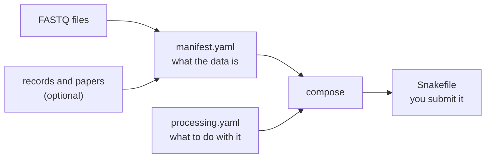

# From FASTQ files to a pipeline

The compiler turns a set of FASTQ files into a pipeline you can run. It works like a compiler for
code: you hand it source, it checks the source, and it writes a program. Here the source is your
sequencing files and what you know about them, and the program is a Snakemake workflow (a
`Snakefile` and its settings). seqforge writes the pipeline. You submit it. seqforge never submits
a job.

This page explains what happens on the way. To do it yourself, see
[Compile step by step](../tutorials/step-by-step.md) or [Compile with Claude](../tutorials/with-claude.md).
Each command's options are in the [command reference](../reference/commands.md).

## What goes in

| Input | Needed? | What it is for |
| --- | --- | --- |
| FASTQ files (`.fastq.gz`) | Yes | The bytes decide what kind of library this is. |
| The genome | Yes | A genome assembly by its UCSC id (the assembly's name in the UCSC Genome Browser), such as `ce11`, and a named gene annotation. This is the one choice with no safe default, so seqforge asks for it. |
| An archive accession | No | The archive's records for each sample, such as an SRA project. Most sequencing data never had one. |
| Papers and notes | No | A paper (`.pdf`, `.txt` or `.md`) or a supplementary `.xlsx` table. A model reads it for claims about the library. You can skip this step and use no model at all. |
| Instructions | No | A document written for seqforge, such as "count introns too". Only this kind of document can change what to do with the data. |

## What comes out

- **The manifest** (`manifest.yaml`) says what the data is: the library type, how each file's reads
  are laid out, the organism and the samples. There is one per dataset.
- **The recipe** (`processing.yaml`) says what to do with it: the genome, the aligner, what to count
  and the computing environment. There can be many per dataset.
- **The pipeline** is a folder that holds the `Snakefile`, its settings, and a table that says where
  every FASTQ file is and which sample and read it belongs to.
- **The sample table** (`sample_metadata.tsv`) has one row per sample.

All of it goes into a `seqforge/` folder in your project. Only `seqforge/cache/` is safe to delete.

## How the library type is found from the bytes

### Filenames are not evidence

`_1` and `_2` in a file name come from whatever wrote the file: an archive's download tool, a
sequencer's demultiplexer, or a script. `SRR123_1.fastq.gz` is not "read 1" in any biological
sense. It might hold the cell barcodes, the RNA, or nothing useful. So seqforge opens the files and
looks.

### It reads only the start of each file

Every look at a FASTQ file is bounded. By default seqforge reads the first 2,000 reads, and never
more than 256 MB once decompressed, whichever comes first. You can raise the read count to sample
more of a large file, but the limit always applies. Reading a whole multi-gigabyte file is treated
as a bug, even when today's file is small. The limits are in reads and bytes, never in seconds,
because time depends on the disk and on how busy the machine is.

From that bounded start, the bytes tell a lot:

- **Which positions are fixed and which vary.** The same base at one position in almost every read
  is adapter sequence, not data. A long run of `T` is a poly-T tail.
- **Which stretches repeat.** Cell barcodes recur, because each cell is sequenced many times. UMIs
  (unique molecular identifiers) and RNA are nearly all distinct. This tells barcodes from UMIs
  without any barcode list.
- **Whether someone trimmed the file before upload.** A sequencing run writes its technical reads at
  one fixed length. If most reads of such a read are another length, a trimming tool ran, and
  trimming tools do not know a barcode from an adapter. seqforge refuses such a file instead of
  reading barcodes from shifted positions.

### The knowledge base says what each technology looks like

The knowledge base holds one entry for each supported technology, such as 10x Chromium 3' v3 or
SPLiT-seq. An entry states what the technology's files hold: for example, one 28-base read with a
cell barcode and a UMI, and one read of RNA. It also states the strand and the barcode list. Each
entry carries its own test, which proves that the entry finds its own technology again. The
[knowledge base](../kb/index.md) lists the supported assays.

seqforge scores every entry against the bytes. For each one, it tries every way of matching your
files to the entry's reads and keeps the best match. A swapped `_1` and `_2` gives the same answer.

### Cheap checks come first

Answers are tried in order of cost, and seqforge climbs only as far as it has to:

| Step | What it uses | How much it counts |
| --- | --- | --- |
| 0 | The prose: a paper or record that says "10x 3' v3" | A hint that says which list to check first. Never a conclusion. |
| 1 | The filenames | A weak hint, never decisive. |
| 2 | The shape of the reads: lengths, fixed and varying positions, repeats | Strong. The bytes are being read anyway. |
| 3 | One barcode list: do these barcodes appear in the vendor's list of real barcodes? | Strong. |
| 7 | A person | Asked only when two technologies tie and would process the reads differently. |

A tie that survives step 3 and would change the output goes to a person as a question. A tie that would not change the output,
such as 10x 3' v3 against v3.1, records both names and asks nothing.

The prose sits at the bottom on purpose. A paper that says "10x v3" turns an open search into a
yes-or-no check of one barcode list. It is trusted enough to skip the search, never enough to skip
the check. When the prose and the bytes disagree, seqforge reports the disagreement, and the bytes
win (see [why you can trust the output](trust.md)).

### Which file is which sample comes from the records

Which sample each file belongs to comes from the archive records, not from the bytes. A
disagreement there, such as a file whose size differs from what the archive says, is a warning and
does not stop the compile.

## The manifest: what the data is

The manifest records facts about data that already exists. The molecules went through the
sequencer and produced those bytes, and nothing you decide later changes that.

- **One per dataset.** A dataset here means one technology. A project that mixes technologies, such
  as 10x v2 and v3 libraries in one Series, splits into **assays**, one per technology, decided from
  the bytes. Each assay gets its own manifest and pipeline under `seqforge/<assay>/`, and
  `project.yaml` lists them. A sample whose files disagree on technology stops the compile.
- **Named by its hash.** A hash is a short fingerprint computed from the content. The manifest's
  hash is computed from what it says about the library and the experiment. The same data gives the
  same hash, on any machine.
- **Written once.** A finished manifest is never rewritten when you change your mind about
  processing.
- **No machine paths.** The genome is a UCSC id plus a registered annotation name, software is a
  named environment, and data is a web or archive address. The manifest means the same thing on
  any machine.

## The recipe: what to do with it

The recipe holds the choices: which genome build, which aligner, what to count. Someone else could
choose differently, and you may choose differently next year. So the recipe is a separate file,
and a dataset can have many recipes. Changing a recipe never changes the dataset's hash.

The line between the two files is between parsing and counting:

- **How to parse the reads** (where the barcode starts, how long the UMI is, which strand) is a fact
  of the technology. The bytes and the knowledge base decide it. No instruction and no paper can
  set it, because the recipe has no field for it.
- **What to count** (genes only, or genes plus introns, against which genome) is a choice. It lives
  in the recipe, and you can set it.

When several sources set the same recipe value, a command-line option wins over an instruction
document, and an instruction wins over seqforge's default. An empty recipe is valid: every value
then takes its default.

Some defaults avoid a question. Whether a 10x library came from whole cells or from nuclei cannot be
read from the bytes, and it changes what to count. So for a droplet single-cell library the default
recipe counts five ways in one pass: exons only, exons plus introns, two variants of that for reads
that touch both, and spliced against unspliced reads. Alignment costs far more than counting, so the extra counts are
close to free.

## The pipeline you submit

`compose` pairs one manifest with one recipe and writes a pipeline folder,
`seqforge/pipeline/<recipe>-<id>/`. The id is computed from the dataset, the recipe, the knowledge
base entry that decided the settings, and the version of the workflow module. Two recipes over one
dataset therefore never write into the same folder, and every pipeline traces back to what made
it. The same inputs always give the same pipeline.

The `Snakefile` uses hand-written, versioned Snakemake modules that ship with seqforge. No model
writes pipeline code. You submit the `Snakefile` to your own machine or cluster. It ends in each
sample's results, such as a count matrix per sample (`<sample>.h5ad`, the AnnData format) for
single-cell RNA, or a fragments file for single-cell ATAC.

`seqforge run` does every step above in order and stops at the first refusal. Run it again and it
resumes from what is already on disk.

## Joining a study's reading

The compiler knows which samples there are, their organism and their technology. It does not know
what each sample was: its tissue, its treatment, its age. A study's reading holds that (see
[Understanding a study](study.md)).

When you name a study folder with `--study`, the compile joins that folder's `reading.yaml` into
`sample_metadata.tsv`. The two meet on the BioSample accession: the manifest sample's accession,
and the `biosample_accession` that the reading's row copied from its GEO record. The table gains
one column per factor and per label that varies across the samples, plus `reading_hash`, which
names the reading it came from. A label that is the same for every sample tells no samples apart,
so it gets no column.

The join never changes the manifest or its hash, and it never stops a compile. Each mismatch is a
warning:

- a compiled sample with no reading row, or one whose BioSample several rows link;
- a reading row with no compiled sample;
- a species that is not the manifest's organism;
- an assay term that does not match the manifest's assay.

For a droplet library, the pipeline's last step copies these labels into each sample's `.h5ad`
file. Without `--study`, nothing is joined.

## The report

`seqforge report` writes one page, `report.html`, and its data, `report.json`, into the folder it
starts from. For a compile, the page shows what seqforge decided and the evidence for it, and the
pipeline's own results once it has run. With `--study`, it also shows the study's bounds, its
design and its samples. The page opens in a browser with no network. The
[example reports](../examples/index.md) show three.
