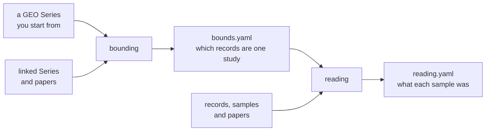

# Understanding a study

A lab deposits its data in GEO, the Gene Expression Omnibus, as one or more Series. A Series is a
deposit, not a piece of research. One paper's experiments can span several Series, and a Series
rarely says in one place what each sample was. The study chain answers two questions for each
study you give it:

1. **Its bounds.** Which GEO Series and which papers are one piece of research?
2. **Its reading.** What was each sample: which factors did the study vary on purpose, which level
   of each was each sample at, and what was it (its species, tissue, assay and so on)?

Each answer is a file in the study's folder: `bounds.yaml`, then `reading.yaml`. This page
explains what the two files claim and how far to trust them. To run the chain yourself, see
[Read your own studies](../guides/read-studies.md). For real output, see the
[example reports](../examples/index.md).

## The bounds say which records are one study

A **study** is one piece of research: the experiments that one paper reports, or one project that
has no paper yet. A study is always made of whole Series. Nothing splits a Series by sample.

Bounding starts from one Series. It gathers that Series, every Series one link away from it, and
every paper any of them links. Then it decides which of these belong:

- Code keeps the starting Series. If the starting Series is a SuperSeries (a Series that only groups
  other Series), code keeps its sub-Series and leaves the SuperSeries itself out.
- For every other Series and every paper, a model answers one question: does this record belong to
  the study? The model is Jev, which answers yes-or-no and multiple-choice questions with a
  probability.
- Code copies the title of each record it placed, kept or left out, into the file.

A record that does not belong is listed as left out, with the reason. The bounding job reads each
record's text and each paper's abstract, nothing more.

## The reading says what each sample was

The reading has one row for each sequenced sample of the kept Series. A sample that was not
sequenced, such as a microarray sample, is left out. The reading holds three kinds of statement:

- **Factors.** A factor is a label the study varied on purpose, such as a treatment or an age. The
  reading names the levels the factor took, the level the others are compared with (its baseline),
  and whether the levels have an order. Each sample's row names its level of each factor.
- **Labels.** There are 18 standard labels, among them species, sex, age, tissue, cell type, cell
  line, disease, genotype, strain, treatment, dose, duration, assay and, for pull-down assays such
  as ChIP-seq, the target and the control type. A study can add a label of its own. A label that
  is the same for every sample is written once, under `shared`.
- **The BioSample accession.** When a sample's GEO record links exactly one NCBI BioSample, the row
  copies its `SAMN…` id. This is an id copied from the record, not a claim. A compile uses it to
  join the reading to its samples (see [From FASTQ files to a pipeline](compiler.md)).

Two models write a reading. A writer model (DeepSeek Flash, with its reasoning mode on) reads the
records and the papers. It lists the factors, every value each label takes, and a quote for each
value. Jev then picks each sample's level and value from those lists. Papers are read in full when
the lab's paper store holds the full text, and by their abstract otherwise.

Some facts follow from the labels, so no file stores them. Code works them out from a valid
reading each time: which samples are replicates, which groups a comparison sets side by side, which
samples run along an ordered factor, which libraries came from one piece of material, and which
control goes with which pull-down.

## Every claim says how it is backed

Each statement in a study file is a **claim**. A claim carries exactly one mark that says how it is
backed, and `p`, the chance it is right:

| Mark | What it means |
| --- | --- |
| `quoted` | A passage in a record or a paper says so. The claim lists the passage numbers. |
| `inferred` | No passage says so directly. The claim says how the value was reached. |
| `unknown` | No answer. The claim carries a note and no probability. |
| `na` | The label does not apply, such as a dose in a study with no treatment. Reading only. |

A claim is `quoted` only after two checks pass. First, code finds the quote in its source. In a
record, the quote must match the field character for character. In a paper, it must match once
each run of spaces and line breaks counts as one space. Second, Jev reads the found passage beside
the claim and judges whether the passage says so. A quote that code cannot find is dropped, so the
claim can be at most `inferred`. A found passage that speaks against a claim is listed under
`against`, so a reader sees the disagreement.

Labels such as tissue, cell type and disease also get an ontology term, a standard id from a
public vocabulary. The terms come from the lab's ontology store. Its search offers candidates for
each value, and Jev picks one or none. A term is written only when Jev's pick is at least 80% sure.
The species comes from the taxonomy id in the sample's own record. The source's own words stay
beside each term, and the file names the dated snapshot of the vocabularies that its ids came from.

## Each question is asked twice

A model's answer counts only where code can check it, and code decides whether it stands. In the
study chain, the check is a second asking.

Jev answers a yes-or-no question with the chance of yes. Code reads that as yes above 0.5 and as no
below. Each question that decides a study is asked twice:

- A yes-or-no question is asked as written, then turned into its negation.
- A multiple-choice question is asked with its options in order, then with the options reversed.

The two answers agree only when both lean the same way. A question that gets no answer never
agrees. An answer that flips when the question is turned around is one the model was not sure of,
whatever its probability said.

Bounding asks twice about every record it places. Reading asks twice about each factor (was it
varied on purpose, and what is its baseline) and about each sample's level of each factor. A
sample's other labels are asked once.

## A study ends settled, unsettled or refused

| Ending | Bounding | Reading |
| --- | --- | --- |
| Settled | Jev's two answers agree on every record. | The two askings agree on every factor, baseline and level. |
| Unsettled | The two answers disagree on at least one record. | The two askings disagree on at least one of those questions, or one went unanswered. |
| Refused | The linked group holds more than 50 Series, Jev gives no answer about a record, or the file fails its format check. | The writer's answer cannot be used after one retry, or the file fails its format check. |

A refused study gets no file. A settled or unsettled study gets a file that passes its format
check. The ending is kept in the job's record of the run, not in the file, and the report does not
show it. For an unsettled study, read the factors and levels with care: at least one of those
answers changed when the question was turned around.

## What it costs

Every run takes a spending limit in dollars and stops when it reaches it. A model call made once is
kept in the cache of the lab's model gateway, so a re-run of the same studies replays from it at
no cost.

On the 50 studies of the standard set, measured on 2026-11-27:

| Job | Settled | Unsettled | Refused | A first run costs |
| --- | --- | --- | --- | --- |
| Bounding | 47 | 3 | 0 | $0.0104 for the 50 |
| Reading | 38 | 12 | 0 | $1.537 for the 50, about 3 cents a study |

Every answer that day came from the cache, so the run paid nothing. A reading with nothing in the
cache took about 22 minutes at four studies at once, on 2026-11-24. The method and the full
numbers are in the dated note
[the study chain on the 50 studies](https://github.com/liuhlab/seqforge/blob/main/docs/research/study-chain-on-the-50-2026-11-27.md).

## What it does not do

- **It reads no sequencing data.** The chain reads archive records and papers only. It opens no
  FASTQ file and no supplementary file.
- **It does not score itself.** Settled means the two askings agreed. It does not mean the reading
  is right. Accuracy is measured by a separate effort, and nothing in the chain grades a reading.
- **It does not compile.** A reading joins into a compile only when you name its study folder (see
  [From FASTQ files to a pipeline](compiler.md)).

The exact fields and rules of the two files are in [the bounds file](../formats/bounds.md) and
[the reading file](../formats/reading.md). Each step in full is in
[the study workflow](../study-workflow.md).
