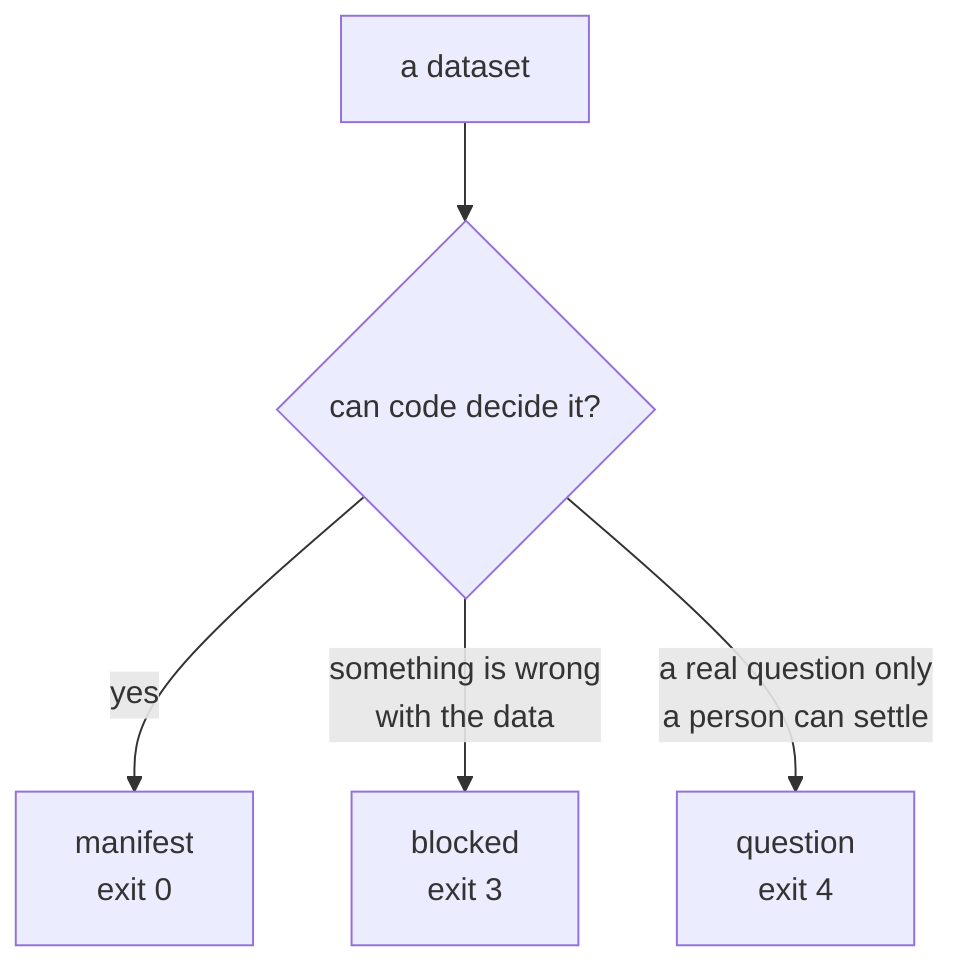

# Why you can trust the output

A tool that always gives an answer is only as good as the person who checks it. Across thousands
of public datasets, nobody checks every answer. So seqforge is built to stop where an ordinary
pipeline would carry on, and to show the evidence for each answer it does give. This page lists the
rules behind that, and then says plainly what seqforge does not promise.

## It refuses rather than guesses

A refusal is an exit code, the number a command returns when it ends, not a line in a log that
nobody reads. A script or a person can act on it.

| Exit | What it means |
| --- | --- |
| 0 | Done. There may be warnings to read, but nothing stopped. |
| 2 | The command could not use its setup, such as an option that names no known technology. |
| 3 | Blocked. Something is wrong with the data itself, or the run reached its spending limit. |
| 4 | A question. Only a person can settle it. Answer it and the compile goes on. |

Each block carries a reason and a fix you can act on. "Could not process" is not a fix. "The
barcode read is missing: download it again with the technical reads, or get the submitter's original
files" is. Code decides whether a compile goes on. A model never does.

## It catches the quiet failures

Loud failures take care of themselves: a corrupt file crashes and you notice. Each failure below
gives a normal-looking result, and an ordinary pipeline exits 0 on all of them.

- **A trimmed barcode file.** A trimming tool ran before upload, so some barcodes sit at shifted
  positions. Those cells match no barcode list and drop out, and the matrix just looks thin.
  seqforge checks whether most reads of a fixed-length read have left that length, and refuses the
  file if they have.
- **Counting only exons on nuclei.** Nuclei are full of unspliced RNA that sits in introns. Count
  only exons and you throw it away: 40.7% of one nuclear library, in a measurement on this project.
  The bytes of a nuclear library look the same as those of a whole-cell one. So for a droplet
  single-cell library, seqforge counts five ways in one pass, and you choose later.
- **The wrong genome.** A worm library against the human genome barely maps, which is loud. The same
  mistake between two similar genomes is quiet, and gives a plausible matrix in the wrong
  coordinates. seqforge has no default genome. You name it.
- **The wrong strand.** Map against the wrong strand and about half the reads go unassigned.
  Public records almost never state the strand. seqforge takes it from the technology's entry in
  the knowledge base, never from a guess.

## It asks only questions that matter

A tool that asks questions all the time is one people work around, and then it protects nobody. So
seqforge does not ask in two cases:

- **The answer would change nothing.** Two technology versions, such as 10x 3' v3 and v3.1, can look
  the same in the reads and also process the reads the same way. Then seqforge records both names
  and moves on.
- **Every answer is affordable.** "Cells or nuclei?" cannot be answered from the reads, so seqforge
  counts every way at once instead of asking.

It asks only where the answers exclude each other: two technologies that tie and would process the
reads differently.

## The bytes win over prose

Every judgement in the manifest says how it came to be known: read from the bytes (observed), claimed by
a person, a paper or an archive (asserted), or worked out by code (inferred). A claim is never a
measurement, however trusted its source.

A paper's statement of the library type is at most a hint about which barcode list to try first.
It never counts as evidence. When the bytes and a record or paper disagree on a fact, seqforge does
not pick a side quietly. It reports the disagreement, with both sides and where each came from, and
stops at exit 4 until a person confirms.

## Every quote must be found in its source

A model that reads prose must quote the words that back each claim. Code then looks for the quote:

- **In the compiler**, the quote must appear in the document, and it must carry the value. For a
  value from a fixed list, such as a technology name, the quote must name that technology. A claim
  that fails either check is rejected.
- **In the study chain**, the quote must appear in its record field character for character, or in
  its paper once spaces and line breaks are evened out. A model then judges whether the found
  passage says what the claim says. A claim whose quote is not found is marked `inferred`, never
  `quoted`. See [Understanding a study](study.md).

## A model answers only where code can check it

A model writes an answer only where code can check it, and code decides whether the answer
stands.

- **No model writes code.** The pipeline is built from hand-written, versioned modules. A model's
  output is data, and code checks it against a fixed format before using it.
- **In the compiler**, one step uses a model: reading papers and records for claims. You can turn it
  off, and the manifest is still correct, only with less in it. The library type comes from the
  bytes either way.
- **In the study chain**, models draw a study's bounds and write its reading. Code finds every
  quote, owns the threshold that turns a probability into yes or no, and asks each deciding
  question twice. An answer that flips when the question is turned around leaves the study
  unsettled.

A model never sets a threshold and never reads a technology from the bytes.

## Cheap checks first

seqforge tries the cheapest evidence first and climbs only on a real tie: the prose, then the
filenames, then the shape of the reads, then one barcode list, and only then a person. The
manifest records which step settled each decision. [From FASTQ files to a pipeline](compiler.md) walks through the
steps.

It reads only a bounded start of each file, by default 2,000 reads or 256 MB decompressed,
whichever comes first. It never reads a whole FASTQ file.

## The same answer on any machine

- **No machine paths.** The manifest names the genome by its UCSC id and a registered annotation
  name, the software by a named environment, and each file by its address. It means the same thing
  on your laptop and on a cluster.
- **Named by its hash.** The manifest is named by a hash of what it says about the data. A new
  recipe never changes it, so a dataset keeps one name however many ways you process it.
- **Every step is saved.** Each stage writes its result to disk. Run a command again and it resumes
  from what is there.

## What it does not promise

- **A settled study is not a correct one.** Settled means the two askings agreed. Accuracy is
  measured by a separate effort, against hand-checked files, and nothing in seqforge grades a
  reading.
- **A record can be wrong.** Which file belongs to which sample, and a sample's BioSample link,
  come from the archive's records. seqforge warns where records disagree with each other or with
  the files, but it cannot correct a record that is wrong and consistent.
- **A claim can sit in the wrong field.** The quote check catches an invented quote and a quote
  pinned to the wrong value from a fixed list. It cannot catch a real quote filed under the wrong
  free-text field. Such a claim never decides the library type, which comes from the bytes.
- **The pipeline still has to run.** seqforge writes the `Snakefile`; you submit it. What the run
  measures comes back in the [report](../examples/index.md) as advice. It never changes a decision
  already recorded.
