<!-- Centered hero logo needs inline HTML and precedes the H1 (MD033, MD041). Scope the exception to
     this block; every other rule stays on for the page. -->
<!-- markdownlint-disable MD033 MD041 -->

  

<!-- markdownlint-enable MD033 MD041 -->

# seqforge

seqforge reads public sequencing studies and their files, and writes down what they are, so that
each dataset can be processed the right way. It does two jobs.

- **It reads a study.** Given a GEO Series, it works out which records and papers make up the study
  (the study's **bounds**). Then it works out what each sample was: the factors the study varied
  on purpose, each sample's level of each, and labels such as species, tissue and assay (the
  study's **reading**).
- **It compiles a dataset.** Given FASTQ files, it works out from the bytes which sequencing
  technology made them and which file holds what. Then it writes a pipeline that you submit to a
  cluster.

One **report** shows a study's bounds and reading, a compiled dataset, or both, on one web page.
**[See three example reports](examples/index.md)** before you read on.

## What goes in, and what comes out

| You give it | It writes | What the file is for |
| --- | --- | --- |
| A GEO Series id | `bounds.yaml` | The Series and papers that make up one study, and the records left out |
| The bounds | `reading.yaml` | What each sample was. Each claim carries a quote, or says it is inferred |
| FASTQ files, and if you have them an accession and a paper | `manifest.yaml` | What the data is: technology, read roles, samples. One per dataset, and it never changes |
| A genome and an annotation | `processing.yaml` | The recipe: what to do with the data. A dataset can have many |
| The manifest and a recipe | A Snakefile and its config | The pipeline you submit. It ends in one count matrix (`.h5ad`) per sample |
| Any of the above | `report.html` | One page to read it all |

## The whole pipeline

```mermaid
flowchart TB
    subgraph STUDY["Reading a study"]
        direction LR
        GEO["GEO and SRA records,<br/>papers"] --> BOUND["bound<br/><i>which records are one study</i>"]
        BOUND --> BY["<span style='color:#fff'><b>bounds.yaml</b></span>"]
        BY --> READ["read<br/><i>what each sample was</i>"]
        READ --> RY["<span style='color:#fff'><b>reading.yaml</b></span>"]
    end
    subgraph COMPILE["Compiling a dataset"]
        direction LR
        FQ["FASTQ files"] --> PROBE["probe<br/><i>read the bytes</i>"]
        PROSE["papers, notes,<br/>archive records"] --> HARVEST["harvest<br/><i>quoted claims</i>"]
        PROBE --> SCORE["score<br/><i>which technology</i>"]
        HARVEST --> SCORE
        SCORE --> MAN["<span style='color:#fff'><b>manifest.yaml</b><br/>what the data is</span>"]
        MAN --> COMPOSE["compose"]
        REC["<span style='color:#fff'><b>processing.yaml</b><br/>what to do with it</span>"] --> COMPOSE
        COMPOSE --> SNAKE["<span style='color:#fff'><b>Snakefile</b><br/>you submit it</span>"]
    end
    MAN --> TSV["sample_metadata.tsv<br/><i>one row per sample</i>"]
    RY -. "joined in by BioSample,<br/>when you ask" .-> TSV
    RY --> REPORT["<span style='color:#fff'><b>report.html</b></span>"]
    SNAKE --> REPORT

    %% The white <span> on every dark-filled label is load-bearing, not decoration. Do not
    %% replace it with `color:#fff` in the classDef below: mkdocs-material renders each diagram
    %% into a *closed* shadow root and styles the label's inner <p> directly, so a classDef
    %% colour lands on the wrapping element and loses to it — the text renders dark-on-dark.
    %% An inline colour on the text itself is the only thing that wins. Same for every dark
    %% node on this site.
    classDef artifact fill:#00695c,stroke:#004d40
    classDef output fill:#37474f,stroke:#263238
    class BY,RY,MAN,REC artifact
    class SNAKE,REPORT output
```

The two halves run on their own. A study can be read without compiling any of its files, and a
dataset can be compiled with no study at all. They meet in the sample table: when you compile with
`--study`, each sample's row takes the reading's factors and labels, matched by its BioSample
accession (the archive's id for the biological sample). The manifest does not change.

## Why you can trust it

- **A model answers only where code can check the answer.** In a reading, every claim quotes a
  passage that code finds again, word for word, in the record or paper. A claim with no such
  passage is marked inferred.
- **Each question is asked twice.** The second time, the options come in reverse order. If the two
  answers differ, the study is marked unsettled, and nothing is guessed.
- **The bytes decide the technology.** A paper that names a kit is a hint. The reads in the files
  decide, and when the two disagree, seqforge stops and says so.
- **It refuses rather than guesses.** A refusal is an exit code with a reason and a suggested fix,
  not a best guess.
- **It never reads a whole FASTQ file.** A small, fixed head of each file is enough.
- **Every study file and manifest is checked against its written format before it is saved.**

[Why you can trust the output](how-it-works/trust.md) explains each point.

## Where it stands

On the **standard set**, 50 GEO studies picked to cover many designs, the latest run drew 47 of the
50 bounds without a disagreement and settled 38 of the 50 readings. It refused none. A first run
over all 50 costs about $1.55 in model calls, or about 3 cents a study. Nothing on this site scores
those readings against a person's answers: measuring accuracy is a separate effort.

## What it does not do

- It does not submit jobs. You run the Snakefile on your own cluster.
- It does not judge its own accuracy.
- Reading a study needs the lab's model gateway and its copy of the GEO and SRA records. Compiling
  calls the gateway only to read prose, such as a paper or the archive's records, and
  `seqforge run --no-llm` skips that step.

## Next

- **See the output:** [Example reports](examples/index.md).
- **Understand it:** [Understanding a study](how-it-works/study.md),
  [From FASTQ files to a pipeline](how-it-works/compiler.md) and
  [Why you can trust the output](how-it-works/trust.md).
- **Use it:** [Getting started](getting-started.md).
- **Look something up:** [Commands](reference/commands.md) and the other Reference pages.
